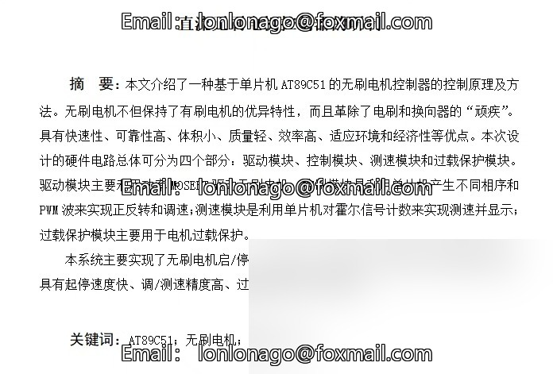
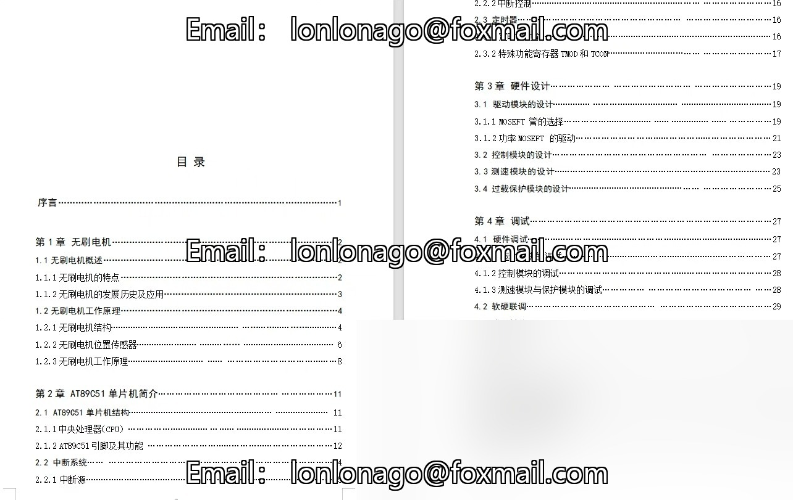
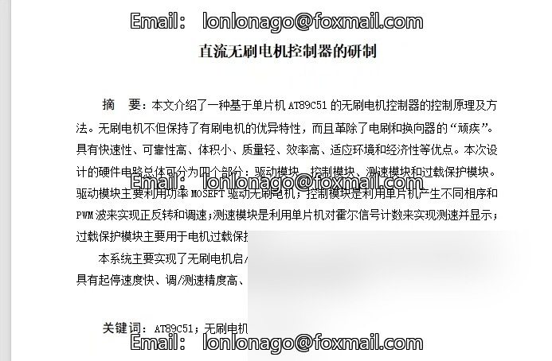
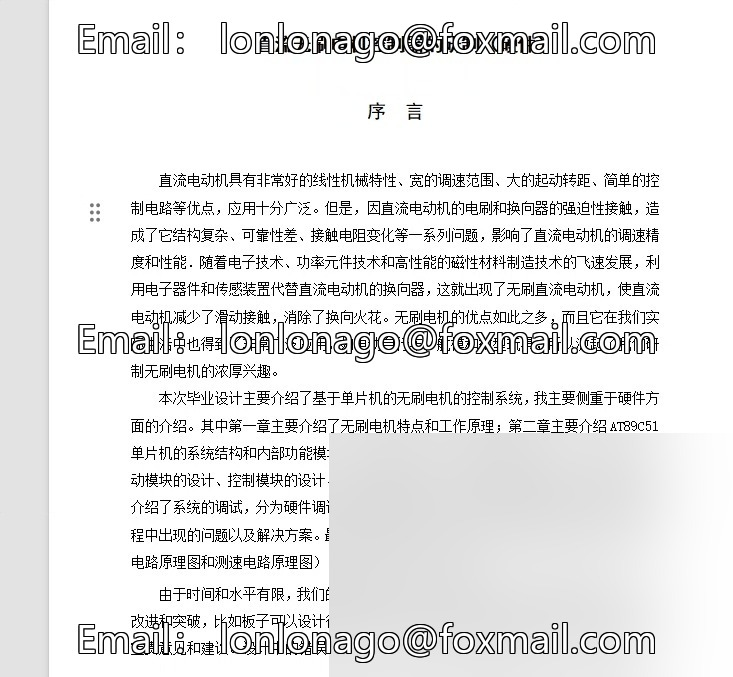

# Developing direct current brushless motor controller (hardware) Based on AT89C51 brushless motor

## Body

Research and development of DC brushless motor controller (hardware) Based on AT89C51 brushless motor controller design
463 This material contains only articles and is for reference only.

The material covers the hardware development of a DC brushless motor controller, the design of a brushless motor controller based on AT89C51, and includes control principles, driver, control, speed and overload protection designs.

<!-- AI_ENRICHED -->

## Images

## Payment

Here is a pay link on Stripe ( https://buy.stripe.com/3cs8yP7sY87d0vu9AB ). Please contact me lonlonago@foxmail.com after funding $89, and I will send you a complete data files , thank you!

